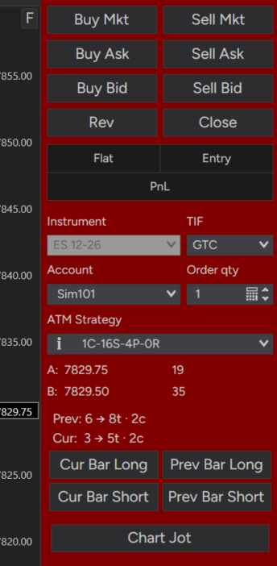

# PATsButtons

A NinjaTrader 8 indicator that enters off the **signal bar** with one click.

It works out how many contracts fit your dollar risk, enters with the ATM template you
assigned to that size, and then moves the ATM's stop to the signal bar. If you'd rather
size trades yourself, set **Sizing = UseChartTrader** and it uses the ATM and quantity
selected in Chart Trader instead.

After entry the ATM manages the trade as usual: targets, breakeven, trailing, and
dragging orders on the chart all work normally.



---

## Quick start

1. Install it. Download [`PATsButtons.cs`](../PATsButtons.cs) into
   `Documents\NinjaTrader 8\bin\Custom\Indicators\`, open the **NinjaScript Editor**, and
   press **F5** to compile. (If an older copy of PATsButtons is already installed, remove
   it first with **Tools → Remove NinjaScript Assembly**.)
2. Open a chart with **Chart Trader** visible and add the **PATsButtons** indicator.
3. In its settings, either:
   - leave **Sizing = RiskBased**, set **Max Risk ($)**, and choose 1 to 5 ATM templates
     under **2. ATM Templates**, or
   - set **Sizing = UseChartTrader** and pick the ATM and quantity in Chart Trader.
4. Pick the account and instrument in Chart Trader. PATsButtons trades whatever is selected there.

The buttons appear in Chart Trader (or the bottom-right of the chart). They're grey while
the chart loads, then switch to NinjaTrader's normal button color when they're ready.

---

## The buttons

```
 [ Cur Bar Long ] [ Prev Bar Long ]
 [ Cur Bar Short] [ Prev Bar Short]
```

| Button | What it does |
|---|---|
| **Prev Bar Long** | Right away, places a buy stop 1 tick above the high of the bar that **already closed**. |
| **Prev Bar Short** | Right away, places a sell stop 1 tick below the low of the bar that already closed. |
| **Cur Bar Long** | Arms (turns green) and waits. When the bar that's printing **closes**, places a buy stop 1 tick above its high. |
| **Cur Bar Short** | Arms and waits for the printing bar to close, then places a sell stop 1 tick below its low. |

The stop is 1 tick beyond the **other** end of the same bar: below the low for a long,
above the high for a short. The offsets can be changed in the settings.

**Clicking again**
- An armed (green) button that hasn't placed its order yet: click it again to disarm.
- An entry that's working but not filled (orange): click **any** button to cancel it. It
  won't cancel once it has partly filled, so you're never left with contracts and no stop.
- Each click places one entry. Buttons don't re-arm themselves.
- Only one button can be armed at a time.

### Button colors

| Color | Meaning |
|---|---|
| **Grey** | Not ready yet (chart still loading), or a setup problem. A notice above the buttons says what's wrong. |
| **NinjaTrader's normal button color** | Ready. Matches Chart Trader's own buttons and follows your NinjaTrader skin. |
| **Green** | Armed, waiting for the bar to close. Label reads *Cancel Long / Cancel Short*. |
| **Orange** | This button's entry order is working. Label reads *Cancel Order*. |
| **Dim grey** | Another button's entry is working. Clicking also cancels it. |
| **Red** | A position is open on that instrument. Buttons are locked; a click just flashes. |

The buttons unlock when the account is **flat** on the instrument, however the trade
ended: stop, target, Chart Trader's Close, Flatten Everything, or by hand. Because the
lock checks the account's position, a trade on that instrument from another tool also
keeps the buttons locked.

---

## How a trade works

Example: ES, Max Risk $300, the signal bar's high is 5000.00 and its low is 4998.00.

1. **Entry** = 5000.25 (high + 1 tick). **Stop** = 4997.75 (low − 1 tick).
2. **Risk** = 10 ticks = $125 per contract → $300 ÷ $125 = **2 contracts**.
3. Of the ATM templates you chose, the largest that fits 2 contracts is `2C-16S-4P-1R`
   (2 contracts), so it places a buy stop for 2 at 5000.25 with that template attached.
4. **Fill**: the ATM places its own stop (16 ticks, 4996.25) and its targets.
5. **Right after**: PATsButtons moves every ATM stop to **4997.75**.

The stop price is saved when the entry is placed. If the order waits several bars before
filling, the stop still refers to the original signal bar.

### Which ATM template is used

- Contracts = Max Risk ÷ (risk in dollars per contract), rounded down.
- From the templates you chose, it uses the **largest one that fits** that number.
- Example with templates of 10, 15 and 20 contracts: the math says 23 → 20. Says 17 → 15.
  Says 12 → 10. Says 7 → **skipped**, because even the smallest doesn't fit.
- With **Sizing = RiskBased**, Chart Trader's **ATM dropdown and quantity box are ignored**.
  Only its account and instrument are used. (With **UseChartTrader**, they're used instead
  of Max Risk and the chosen templates.)

> **Tip:** give your templates a stop **wider than any signal bar you'd trade**. For a
> split second after the fill the template's own stop is live. A wide one means the move
> to the signal bar always tightens it.

---

## Settings

### 1. Risk

| Setting | Default | What it does |
|---|---|---|
| **Sizing** | RiskBased | **RiskBased:** contracts from Max Risk, ATM from the templates you choose. **UseChartTrader:** no sizing; uses the ATM and quantity selected in Chart Trader, and Max Risk and the chosen templates are ignored. See below. |
| **Max Risk ($)** | 0 | Most dollars to risk per trade. Sets the number of contracts. **No trades while it's 0.** Uses the dollar value of the instrument selected in Chart Trader (ES, MES, NQ…), so set it for the instrument you trade. |
| **Entry Offset Ticks** | 1 | Ticks beyond the signal bar's high (long) or low (short) for the stop entry. |
| **Stop Offset Ticks** | 1 | Ticks beyond the signal bar's other end where the ATM's stop is moved. |
| **Use Limit When Price Is Past Entry** | Off | If price is already beyond the entry when the order would go in, a stop entry would be rejected. **Off:** skip and say why. **On:** place a **GTC limit at the entry price** that waits for a pullback, until it fills or you cancel it. |

#### Sizing = UseChartTrader

For traders who manage their own risk. Each click uses the **ATM strategy and quantity
selected in Chart Trader**, the same way Chart Trader's own buttons do.

When you pick UseChartTrader, **Max Risk ($)** and the **2. ATM Templates** group are hidden
in the settings window. Switch back to RiskBased and they reappear with their values.

Everything else works the same: the buttons, entry and stop off the signal bar, moving
the ATM's stop to the signal bar, Lock Initial Stop, Good Close, the 5:1 filter (using the
selected ATM's first target), the pullback limit, and the target mark. The Bar Range lines
show the total risk in dollars instead of contracts, e.g. `Cur: 14 → 16t · $400`. The
contract count is whatever Chart Trader's quantity box says, so it wouldn't change from bar
to bar; the dollar amount (ticks × tick value × quantity) is what you'd lose if the stop is hit.

### 2. ATM Templates

Five dropdowns, **ATM 1** through **ATM 5**. Used only when **Sizing = RiskBased**.

You're choosing which ATM templates the indicator **may** use. When you load it, it reads
each template's contract quantity and sorts them from smallest to largest. On each trade it
works out how many contracts your risk allows and uses the **largest chosen template that
fits**. If even the smallest doesn't fit, the trade is skipped.

- **Any naming works.** The quantity is read from inside the template, not from its name,
  so you don't need names like `2C-16S-4P-1R`.
- **One or two is fine.** Pick as few templates as you like. With only one, every trade uses
  it, as long as the risk allows that many contracts.
- **Any order.** Which dropdown you use doesn't matter. They're sorted by quantity.
- **No duplicate quantities.** If two choices have the same number of contracts, the
  indicator won't trade, and a warning above the buttons names the two that clash.
- Each dropdown lists every saved ATM template with its quantity, e.g. `2C-16S-4P-1R (2)`,
  plus **None**.
- The dropdowns are filled when the settings window opens. If you create a new template,
  close and reopen the window to see it.
- Templates are read when the indicator loads. If you edit a template while it's
  running, reload the indicator (right-click the chart → **Reload NinjaScript**, or re-apply
  its settings) so PATsButtons sees the change.

### 3. Filters

| Setting | Default | What it does |
|---|---|---|
| **Use Good Close** | On | Skip a long if the signal bar didn't close near its high, or a short if it didn't close near its low. |
| **Good Close Fraction** | 0.34 | How near. 0.34 = a long needs the close in the top 34% of the bar; a short in the bottom 34%. When a click is blocked by this filter, **"Failed Good Close Fraction"** flashes above the buttons for a few seconds. |
| **Use 5:1 Filter** | Off | For **Apex Legacy accounts** and their 5:1 risk-to-reward rule. Skips the trade if the ticks from entry to stop are more than 5 × the ATM template's first target. Example: 4-tick target → any stop over 20 ticks is skipped. |

### 4. Stop

| Setting | Default | What it does |
|---|---|---|
| **Lock Initial Stop** | Off | Until **Target 1** fills, you can drag the stop **tighter** (it becomes the new limit) but not **looser**. A looser drag snaps back. After Target 1 fills, the stop is free again. |

### 5. Bar Range

| Setting | Default | What it does |
|---|---|---|
| **Show Bar Range** | Off | Two lines above the buttons, in the chart's text color. |
| **Font Size** | 13 | Size of those lines. |

```
Prev: 20 → 22t · skip (5:1)
Cur:  14 → 16t · 2c
```

- **Prev** = the closed bar the Prev Bar buttons would use. It changes when a bar closes.
- **Cur** = the printing bar the Cur Bar buttons would use. It updates every tick.
- Each line reads **bar range → risk in ticks · contracts** (with UseChartTrader: total risk
  in dollars, e.g. `$400`), or the reason it would skip:
  `skip (5:1)`, `skip (risk)` (even 1 contract is over Max Risk), or `set Max Risk`.
- The Good Close filter isn't included, because the close isn't final until the bar ends.

### 6. Target Fill Prediction

A short mark on the **printing bar** showing where price has to reach for your first
target to fill. It helps you see whether there's room before an EMA or support/resistance.

| Setting | Default | What it does |
|---|---|---|
| **Show Target Mark** | Off | Turns the mark on. |
| **Target Fill Prediction** | 5 | Ticks beyond the **entry** where the first target should fill. Mark = bar high/low + Entry Offset + this value. |
| **Thickness** | 2 | Line thickness. |
| **Width (x bar width)** | 1 | 1 = as wide as the bar, 2 = twice as wide. Follows zoom. |
| **Color** | Yellow | Mark color. |

- If the bar is trading **above its open**, the mark is above the high (long side).
- If it's **below its open**, the mark is below the low (short side).
- If price is **at the open**, there's no mark.
- Example: high 5000.00, Entry Offset 1, Target Fill Prediction 5 → mark at **5001.50**.

### 7. Logging

| Setting | Default | What it does |
|---|---|---|
| **Detailed Logging** | Off | Adds step-by-step lines (signal bar values, sizing math) to the Output window. |

These are always printed, with or without Detailed Logging:
- the templates loaded at startup
- every order placed, and why a trade was skipped
- every stop moved or snapped back
- lock on and off, and errors

### 8. Panel

| Setting | Default | What it does |
|---|---|---|
| **Panel Location** | ChartTrader | **ChartTrader:** the buttons and Bar Range lines sit inside Chart Trader, above Chart Jot if you have it. They stretch with Chart Trader's width and match its text and buttons. **Chart:** bottom-right of the chart. If Chart Trader isn't open, they go on the chart. |

### NinjaTrader's own sections

**Data Series**, **Setup** and **Visual** are added by NinjaTrader to every indicator.
Leave them at their defaults, except:

- **Setup → Calculate must stay "On each tick."** The Cur Bar buttons, the Cur line, and
  the target mark need every tick.
- **Visual → Panel** should stay on the price panel.

---

## Good to know

- **Reloading during a trade:** Reload NinjaScript, re-applying settings, or rewinding Playback
  restarts PATsButtons, and it loses track of the trade. The ATM keeps running, but the
  stop won't be moved or locked. Reload when you're flat.
- **Playback:** works with the **Playback101** account. Market Replay data (with bid/ask)
  works best.
- **Stop entries** are TIF **Day**. Only the pullback limit from *Use Limit When Price Is
  Past Entry* is **GTC**.
- **Chart vs. Chart Trader instrument:** the signal bar comes from the chart. The order and
  the dollar math use the instrument selected in Chart Trader.
